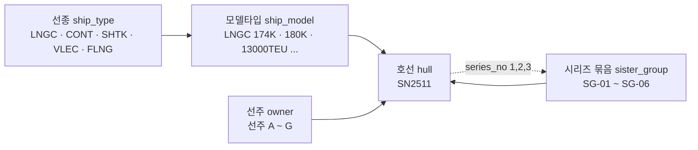

# SPEC — 호선 기준정보와 임시 데이터

> 범위: `meeting` 시스템의 **호선 기준정보**(호선번호·선종·모델타입·선주·시리즈 번호) 정의와, 화면·추출을 돌려보기 위한 **임시 데이터 13호선**.
> 데이터 파일: `data/samples/masters/*.csv` — 실제 데이터로 바꿀 때는 **CSV만 교체**한다(`modules/seed.py` 문서화된 규칙).

## 한 줄로

호선 하나를 가리키는 말은 네 층으로 나뉜다 — **선종**(무슨 배인가) → **모델타입**(어느 규격인가) → **시리즈**(같은 도면으로 몇 번째인가) → **호선**(그 배 한 척). 지금 저장소에는 ①선종 ②선주 ③시리즈 묶음까지만 있고, **모델타입과 시리즈 순번이 없다.** 이 문서는 그 두 칸을 더하고, 13호선 분량의 임시 데이터를 확정한다.

---

## 1. 호선번호 규칙

| 항목 | 규칙 |
|---|---|
| 형식 | `SN` + 숫자 4자리 (`SN2511`) |
| 앞 2자리 | 착수 연도 뒤 2자리 (`25` = 2025년 착수) |
| 뒤 2자리 | 그 해의 일련번호 (`11` = 11번째) |
| 저장 형태 | **항상 `SN` 접두어 포함.** 입력이 `2511`·`S2511`·`sn2511`로 와도 `ensure_sn`이 `SN2511`로 모은다 |
| 적용 지점 | `seed.py`의 `hull_cols`에 등록된 칸 — `hull.id`, `installed_equipment.hull_id`, `alias.scope_hull_id` |

호선번호는 **사람이 외우는 유일한 ID**다. 그래서 자동 발급하지 않고 현장 번호를 그대로 쓴다. 반대로 블록 ID(`ISS-2026-0142` 등)는 서버만 발급한다 — 같은 'ID'라는 말이지만 규칙이 정반대라는 점을 섞지 않는다.

## 2. 표 5개와 관계



읽는 방향은 하나다. **선종이 모델타입을 품고, 모델타입·선주·시리즈가 호선에 붙는다.** 호선에서 시리즈로 돌아가는 점선은 순번(`series_no`)이 호선 쪽에 저장된다는 뜻이다.

| 표 | 한 줄 정의 | 행 수(임시) | 상태 |
|---|---|---|---|
| `ship_type` | 배의 종류. 가장 거친 분류 | 5 | 기존 — 행만 추가 |
| `ship_model` | 선종 안의 **규격·사이즈**. 같은 모델이면 도면·장비 구성이 거의 같다 | 7 | **신설** |
| `owner` | 선주 | 7 | 기존 — 행만 추가 |
| `sister_group` | 같은 도면으로 연속 건조되는 **묶음** | 6 | 기존 — 행만 추가 |
| `hull` | 호선 한 척 | 24 | 기존 — **칸 2개 추가** |

## 3. 칸 정의

### 3-1. `ship_model` (신설)

| 칸 | 형 | 필수 | 설명 |
|---|---|---|---|
| `id` | String(32) PK | ● | `SM-` + 약호. 예: `SM-LNG174` |
| `ship_type_id` | FK → `ship_type.id` | ● | 어느 선종의 규격인가 |
| `code` | String(32) | ● | 기계가 맞춰 보는 표기. 예: `174km3 LNG` · `13000TEU` (2026-11-12 확정, §9-1) |
| `name` | String(64) | ● | 사람이 읽는 이름. 예: `LNG 운반선 174K` |
| `capacity` | Integer | ○ | 적재량 숫자만 |
| `capacity_unit` | String(16) | ○ | `㎥` · `TEU` · `DWT` · `t/년` |

적재량을 숫자와 단위로 쪼갠 이유는 **비교·정렬 때문**이다. `"174,000㎥"` 한 칸으로 두면 "180K 이상만"이라는 조회가 문자열 비교가 되어 깨진다.

### 3-2. `hull` 추가 칸

| 칸 | 형 | 필수 | 설명 |
|---|---|---|---|
| `model_id` | FK → `ship_model.id` | ○ | 모델타입. **신설** |
| `series_no` | Integer | ○ | 시리즈 안 순번. 1부터. 단독선은 빈 칸. **신설** |

기존 칸은 그대로다 — `id`, `ship_type_id`, `owner_id`, `sister_group_id`, `stage`, `delivery_date`, 그리고 pjtlist 동기화로 들어온 `title`·`dock`·`ship_class`·`source`.

`ship_type_id`를 지우지 않고 남기는 이유: 모델이 비어 있는 호선(초기 등록·설계 단계)도 선종만으로 묶을 수 있어야 하고, 기존 화면·조회가 이미 선종을 쓰고 있다. 대신 **"호선의 선종 = 그 호선 모델의 선종"**이 깨지면 안 되므로 검증 규칙으로 잡는다(§7-2).

### 3-3. `stage` 어휘

**지금 데이터에 들어 있는 값 (5개)**

`설계` → `건조` → `시운전 1단계` → `시운전 2단계` → `인도`

자유 문자열 칸이지만 **값을 묶어 쓴다.** 어휘를 고정하지 않으면 "시운전2"·"시운전 2차"·"T/C 2단계"가 섞여 주간 집계가 호선 수를 다르게 센다.

**목표 어휘 (2026-11-12 확정)**

| 값 | 구간 |
|---|---|
| `안벽기간` | **시운전·앵카링·Layup을 뺀 나머지.** 기본값이다 |
| `시운전기간` | `ST` + `GasT` |
| `앵카링기간` | `AC` + `Cold` |
| `Layup` | `WF` ~ `DL` |
| `인도선` | 인도 완료. §7-7이 이 값으로 인도일을 확인한다 |

구간 코드(`ST`·`GasT`·`AC`·`Cold`·`WF`·`DL`)의 출처는 `data_manager`의 `milestone.parquet`과 `trial_schedule.parquet`이다 (§10-1).

**이 값은 사람이 고르지 않는다.** 호선 이벤트 일정에서 **입력 시 계산으로 추정한다.**
즉 `stage`는 손으로 적는 값이 아니라 **일정에서 나오는 파생 값**이고, 그 일정은 **사내 시스템(pjtlist 등)에서 들어온다.**
사외망 작업본에서는 샘플 CSV로 대신한다 — 사내망 전환 지점이 하나 늘어난다.

> **아직 계산하지 않는다.** 입력이 되는 호선 이벤트 일정이 이 저장소에 없다(§10).
> 그래서 진행 호선 11척은 옛 표기(`시운전 1단계`·`시운전 2단계`)를 그대로 두고,
> `_check.py`의 `STAGES`가 목표 어휘 5개와 옛 표기 2개를 **함께** 받는다.
> §10이 정해지면 11척의 값을 계산해서 바꾸고 옛 표기 2개를 지운다.

## 4. 모델타입을 별도 표로 둔 이유

선택지는 셋이었다 — ① `hull`에 글자 칸 하나 ② `sister_group.name` 안에 녹여 두기(지금 상태) ③ 별도 표. 셋 중 **③**을 고른 근거는 이렇다.

같은 모델이면 **탑재 장비 구성이 거의 같다.** 그래서 "174K LNGC에서 생긴 이 증상, 다른 174K에도 있었나?"가 가장 자주 나오는 질문이 된다. 모델이 글자 칸이면 이 질문은 `LIKE '%174%'`가 되고, `174K`·`174k`·`174,000㎥`가 섞인 순간 답이 틀린다. 표로 두면 같은 질문이 `model_id = 'SM-LNG174'` 한 줄이 된다.

그리고 모델에는 **모델 자신의 속성**(적재량·단위, 나중에는 표준 장비 목록·표준 시운전 항목)이 붙는다. 붙을 속성이 있는 것은 칸이 아니라 표여야 한다.

`sister_group.name`에 녹여 두는 방식의 한계도 분명하다. `"LNGC 174K 선주A 시리즈 (SN2510~SN2512)"`는 사람에게는 충분하지만, **단독선에는 시리즈가 없어서 모델을 알 길이 없다.** 임시 데이터 13척 중 4척이 단독선이다.

## 5. 시리즈를 둘로 나눈 이유

시리즈는 **묶음**과 **순번**이 다른 질문에 쓰인다.

| 쓰임 | 쓰는 칸 | 예시 질문 |
|---|---|---|
| 같은 도면 배들을 한 덩어리로 보기 | `sister_group_id` | "이 시리즈에서 같은 문제가 몇 호선에 났나" |
| 그 덩어리 안의 순서 | `series_no` | "1번선에서 났던 문제가 2번선에서도 났나 / 2번선부터 대책이 반영됐나" |

순번이 중요한 이유는 **대책 반영 시점이 순번으로 끊기기** 때문이다. "SN2511(2번선)부터 배관 지지대 보강 반영"처럼 적히는 조치는 순번 없이는 기록할 수 없다. 묶음 ID만 있으면 "같은 시리즈"는 알아도 "그 다음 배"를 알 수 없다.

단독선은 두 칸 모두 빈 칸으로 둔다. `series_no`만 있고 `sister_group_id`가 없는 행은 **오류**다(§7-3).

**부여 기준은 계약 순서다** (2026-11-12 확정, §9-3). 번호가 변하지 않아 과거 기록이 흔들리지 않는 쪽을 골랐다.

그 대신 **대책 반영 시점은 순번이 아니라 호선 ID로 적는다.** "2번선부터 보강 반영"이 아니라 **"SN2511부터 보강 반영"**이다.
계약 순서는 착수 순서와 어긋날 수 있어서, 순번으로 적으면 실제로 대책이 들어간 호선과 달라진다.
`series_no`는 **표시·정렬용**으로만 쓴다.

## 6. 임시 데이터 — 13호선

기준일 2026-11-10. 시리즈 5묶음 9척 + 단독선 4척.

**진행 호선만 담는다** (2026-11-12 결정). 커미셔닝팀이 다루는 것은 안벽에 들어온 뒤의 호선이므로
설계·건조 중인 호선 9척은 샘플에서 뺐다. 인도선은 **2척만 남겼다** — 인도 여부를 확인하는 §7-7을
돌릴 대상이 필요하고, `SN2510`은 `SG-01`의 1번선이라 빼면 그 묶음의 순번이 2·3으로 시작해 §7-4가 깨진다.

| 호선 | 선종 | 모델 | 선주 | 시리즈 | 순번 | 단계 | 인도일 |
|---|---|---|---|---|---|---|---|
| SN2402 | LNGC | LNGC 174K | B | — | — | 인도선 | 2025-06-30 |
| SN2508 | CONT | CONT 13000TEU | A | — | — | 시운전 2단계 | 2026-12-20 |
| SN2509 | LNGC | LNGC 174K | A | — | — | 시운전 2단계 | 2026-11-30 |
| SN2510 | LNGC | LNGC 174K | A | SG-01 | 1 | 인도선 | 2026-09-15 |
| SN2511 | LNGC | LNGC 174K | A | SG-01 | 2 | 시운전 2단계 | 2026-12-10 |
| SN2512 | LNGC | LNGC 174K | A | SG-01 | 3 | 시운전 1단계 | 2027-02-20 |
| SN2514 | LNGC | LNGC 174K | B | — | — | 시운전 1단계 | 2027-03-15 |
| SN2601 | LNGC | LNGC 180K | C | SG-03 | 1 | 시운전 2단계 | 2026-12-28 |
| SN2602 | LNGC | LNGC 180K | C | SG-03 | 2 | 시운전 1단계 | 2027-03-10 |
| SN2620 | CONT | CONT 13000TEU | D | SG-04 | 1 | 시운전 2단계 | 2026-12-18 |
| SN2621 | CONT | CONT 13000TEU | D | SG-04 | 2 | 시운전 1단계 | 2027-02-05 |
| SN2631 | SHTK | 셔틀탱커 125K | E | SG-05 | 1 | 시운전 1단계 | 2027-01-25 |
| SN2641 | VLEC | 에탄 운반선 98K | F | SG-06 | 1 | 시운전 1단계 | 2027-04-02 |

분포: 선종 LNGC 8 / CONT 3 / SHTK 1 / VLEC 1 — 단계 인도선 2 / 시운전 2단계 5 / 시운전 1단계 6.

**`시운전 1단계`·`시운전 2단계`는 옛 표기다.** 새 어휘(§3-3)의 값은 호선 이벤트 일정에서 계산하는데
그 일정이 아직 없어(§10) 지금은 옛 표기를 그대로 둔다. §10이 정해지면 11척의 값을 계산해서 바꾼다.

**빠진 호선이 남긴 것**

- `SG-02`(SN2433·SN2434)는 두 척 다 인도돼 **소속 호선이 없는 묶음**으로 남았다. 기준정보에서 지우지는 않았다 — 실데이터에서도 전원 인도된 시리즈는 생긴다.
- `ship_type`의 `ST-FLNG`, `ship_model`의 `SM-FLNG2M`·`SM-CNT2700`, `owner`의 `OW-G`는 이제 **쓰는 호선이 없다.** 기준정보는 목록이므로 남겨 둔다.

### 6-1. 임시 데이터에 **일부러** 넣은 것

이 데이터는 "그럴듯한 24줄"이 아니라 **화면과 추출이 걸려 넘어지는 자리를 미리 밟아 보기 위한 것**이다.

| 넣은 상황 | 어느 호선 | 무엇을 시험하는가 |
|---|---|---|
| 같은 모델 · 다른 선주 시리즈 2개 | SG-01(선주A) / SG-02(선주B) 둘 다 174K | "같은 모델 사례 찾기"가 선주를 넘어 작동하는가 |
| 같은 선종 · 다른 모델 | 174K vs 180K / 13000TEU vs 2700TEU | 선종만으로 묶으면 안 되는 자리를 드러낸다 |
| 시리즈 없는 단독선 6척 | SN2402·2508·2509·2514·2650·2651 | 시리즈 칸이 비어도 모델로 묶이는가 |
| 묶음 길이 2·3·4 척 혼재 | SG-02(2) / SG-01(3) / SG-03(4) | 순번 표시가 길이에 따라 깨지지 않는가 |
| 단계 5종 모두 등장 | — | 단계별 필터·집계가 빈 구간 없이 돌아가는가 |
| 인도 완료 4척 | SN2402·2433·2434·2510 | 끝난 호선이 주간 집계에서 빠지는가 |
| 선종 1척뿐인 모델 | SN2650 FLNG | 비교 대상이 없을 때의 화면 |
| 선주 D가 시리즈 + 단독선 동시 보유 | SG-04 + SN2651 | 선주별 묶기와 시리즈별 묶기가 섞이는 자리 |

### 6-2. 일부러 **넣지 않은** 것

`installed_equipment`(탑재장비)·`symptom_code`(증상)·`cause_code`(원인)·`alias`(별칭)는 이 문서 범위가 아니다. 다만 **호선 13척에 비해 이 표들이 거의 비어 있다는 것이 지금 가장 큰 불균형**이다(증상 4행·원인 6행·별칭 14행·탑재장비 7행). 호선을 늘려도 "이 증상 다른 호선에도 있었나"는 여전히 답이 나오지 않는다 — 막힌 곳은 코드가 아니라 데이터다.

## 7. 검증 규칙

`data/samples/masters/_check.py`로 7개를 확인한다. 적재(`seed_masters`) **전에** 돌린다 — 끊긴 연결을 DB에 만들지 않는 것이 목적이다.

| # | 규칙 | 어기면 생기는 일 |
|---|---|---|
| 1 | 호선번호가 `SN` + 4자리 | 별칭·장비의 호선 참조가 다른 호선을 가리킨다 |
| 2 | `hull.ship_type_id` = `ship_model.ship_type_id` | 선종 집계와 모델 집계의 호선 수가 어긋난다 |
| 3 | `series_no`가 있으면 `sister_group_id`도 있다 | 어느 시리즈의 몇 번째인지 알 수 없다 |
| 4 | 묶음마다 순번이 1부터 연속 | "다음 배"를 찾을 수 없다 |
| 5 | 한 묶음 안은 같은 모델·같은 선주 | 시리즈 전개 비교의 전제가 깨진다 |
| 6 | `stage`가 어휘 5개 안 | 주간 집계가 호선을 다르게 센다 |
| 7 | `stage`=인도면 인도일 과거, 아니면 미래 | 지난 호선이 열린 호선으로 잡힌다 |

현재 24행 전부 통과한다.

## 8. 코드에서 손대야 하는 곳 — 3군데

| # | 파일 | 무엇을 |
|---|---|---|
| 1 | `app/models/masters.py` | `ShipModel` 클래스 신설 + `Hull`에 `model_id`·`series_no` 추가 |
| 2 | `app/services/seed.py` `_TABLES` | `("ship_model", m.ShipModel, (), ("capacity",), (), None)`을 **`ship_type` 다음, `hull` 앞에** 끼운다. 이 목록은 **FK 순서**라서 위치가 곧 적재 순서다 |
| 3 | `app/services/seed.py` `_TABLES`의 `hull` 행 | `int_cols`를 `()` → `("series_no",)`. 지금 그대로면 `series_no`가 문자열로 들어가 순번 정렬이 `1, 10, 2`가 된다 |

`app/services/masters.py`의 `KINDS`에 `ship_model`을 더하면 `/api/masters/ship_model`이 바로 열린다(14 → 15종).

CSV가 없으면 `seed_masters`는 `"ship_model.csv 가 없어 건너뜀"` 경고만 남기고 계속 진행한다 — 즉 **2번만 하고 CSV를 안 넣어도 기존 적재는 깨지지 않는다.** 순서를 거꾸로 해도(CSV만 넣고 코드 미수정) 조용히 건너뛴다. 이 두 경우가 "왜 모델이 안 보이지"의 가장 흔한 원인이 될 것이므로, 적재 후 **경고 목록을 반드시 읽는다.**

## 9. 정해야 할 것

**4건 모두 2026-11-12에 결정됐다.** 남은 미결은 §10으로 옮겼다.

| # | 항목 | 결정 | 반영 |
|---|---|---|---|
| 9-1 | 모델 약호 표기 | **`174km3 LNG` · `13000TEU` 꼴.** 셔틀탱커·VLEC·FLNG 3종은 지금 표기를 그대로 둔다 | ✅ `ship_model.csv` 4행 교체, §3-1 |
| 9-2 | 모델 분해 수준 | **적재량까지 유지.** 더 쪼개지 않는다 | ✅ 변경 없음 |
| 9-3 | `series_no` 부여 기준 | **계약 순서.** 대책 반영 시점은 순번이 아니라 **호선 ID로** 적는다 | ✅ §5 |
| 9-4 | 단계 어휘 | **`안벽기간`·`시운전기간`·`앵카링기간`·`Layup` + `인도선`**, 값은 호선 이벤트 일정에서 **계산으로 추정** | 🔸 §3-3 어휘·구간 확정, §6 샘플을 진행 호선 11척 + 인도선 2척으로 정리. **값 계산은 §10 선행** |
| — | 선주 실명 | 임시 데이터이므로 익명 유지. 실데이터 전환 시 CSV만 교체 | ✅ 변경 없음 |

### 9-A. 이름을 바꾸지 않는다 (2026-11-12 지시)

**표 이름과 칸 이름(CSV 헤더)은 바꾸지 않는다.** 사내망 전환 때 **헤더 값만 매칭**해서 실데이터를 끼우기 때문이다.

- 바꿔도 되는 것: 칸 **안의 값** (9-1의 `code` 교체가 그 예)
- 바꾸면 안 되는 것: 표 이름, 칸 이름, 칸 순서
- 칸을 **추가**하는 것도 헤더가 바뀌는 일이다. 필요하면 먼저 묻는다

`diagnostics/check_data.py`가 15표의 헤더를 그대로 고정해 두고 매번 확인한다. 헤더가 바뀌면 바로 `EXIT=1`로 걸린다.

## 10. 정해야 할 것 — 호선 이벤트 일정

§9-4가 여기에 걸려 있다. 출처(10-1)와 계산 규칙(10-2)은 정해졌다. 남은 것은 10-3의 두 가지다.

이 저장소가 가진 날짜는 `hull.delivery_date`(인도일) **하나뿐**이라, 사내망 표를 받아야 구간을 가를 수 있다.

**정해진 것 (2026-11-12)**

| 항목 | 결정 |
|---|---|
| 기록할 이벤트 | 시운전 출항·귀항 / 앵카링 시작·해제 / Layup 시작·해제. **안벽 접안은 받지 않는다** — 안벽기간은 나머지로 계산한다. 인도일은 `hull.delivery_date`에 이미 있다 |
| 어디서 오는가 | **사내 시스템(pjtlist 등)에서 들어온다.** 사람이 화면에서 넣지 않는다. 사외망에서는 샘플 CSV로 대신한다 |
| 어떤 표인가 | **별도 표.** 호선 1건에 이벤트 여러 건. `hull`에 날짜 칸을 더하지 않는다 — 헤더가 바뀌어 §9-A에 걸린다 |
| 과거 호선 | 진행 호선이 아닌 것(설계·건조)은 **다루지 않는다.** 샘플에서도 뺐다(§6). 인도선은 `인도선` 값을 그대로 쓴다 |

### 10-1. `data_manager`에서 확인한 것 (2026-11-12)

출처: <https://github.com/kuku5417-wq/data_manager> 의 `DATA_SCHEMA.md`.

**받는 표: `milestone.parquet` 하나다** (2026-11-12 결정). `trial_schedule`은 받지 않는다.
**칸 이름은 헤더 그대로 쓴다** — §9-A대로 우리가 짓지 않는다.

**`milestone.parquet`** — 호선 마일스톤 (MySQL `pjtevnt` 미러, **wide 그대로. unpivot 하지 않는다**)

| | |
|---|---|
| 키 | `project` — 호선번호, `ensure_sn` 적용. 우리 `hull.id`와 같은 값이고 **이름만 다르다** |
| 칸 | `PLAN<EVT>` 계획일 · `PROS<EVT>` 예정일(전망) · `PERF<EVT>` 실적일 — 17 이벤트 × 3계열 = 51칸 + 키 = 52칸 |
| 이벤트 17종 | `LC` 기공 · `SP` · `BT` · `GT` · `CMR` · **`ACFROM`/`ACTO` 앵커링** · `COLDFROM`/`COLDTO` · `IE` · `MT` · `GASFROM`/`GASTO` · `STFROM`/`STTO` · `WF` 진수 · `DL` 인도 |

> `ACFROM`/`ACTO`는 `DATA_SCHEMA.md`(2026-08-11 스냅샷)에 없지만 **운영 `pjtevnt`에 있다**(2026-11-12 확인).
> 문서가 "운영 DB에 이벤트가 추가되면 컬럼이 늘어난다"고 경고한 그대로다. `SELECT *`이므로 코드 수정 없이 들어온다.

**구간 코드가 어디서 오는가**

| 우리 단계 | 사용자 표기 | `milestone`에서 |
|---|---|---|
| `시운전기간` | ST + GasT | `STFROM`~`STTO`, `GASFROM`~`GASTO` |
| `앵카링기간` | AC + Cold | `ACFROM`~`ACTO`, `COLDFROM`~`COLDTO` |
| `Layup` | WF ~ DL | `pjtlist`의 `WORKFINISH` ~ `milestone`의 `DL` |
| `안벽기간` | 나머지 | 위 셋을 뺀 구간 |
| `인도선` | — | `DL`이 지남 |

> **네 구간이 모두 `milestone` 하나에서 나온다.** `trial_schedule`을 받지 않아도 계산이 성립한다.
> `AC`는 `trial_schedule.일정구분`의 값으로도 나오지만, 같은 구간이 `milestone`에
> `ACFROM`/`ACTO`로도 있으므로 그쪽을 쓴다.

### 10-2. 계산 규칙 (2026-11-12 확정)

**① 날짜 하나를 고르는 법 — `milestone`은 세 계열이다**

`PERF`(실적) → `PROS`(전망) → `PLAN`(계획) 순으로 내려가며 **처음 값이 있는 것**을 쓴다.
지난 구간은 실제대로, 앞으로는 최신 전망으로 보인다.

**② 구간 넷의 경계**

| 단계 | 경계 | 출처 |
|---|---|---|
| `시운전기간` | `STFROM` ~ `STTO`, `GASFROM` ~ `GASTO` | `milestone` |
| `앵카링기간` | `ACFROM` ~ `ACTO`, `COLDFROM` ~ `COLDTO` | `milestone` |
| `Layup` | **`WORKFINISH` ~ `DL`** — 공사가 끝나고 인도까지 대기 계류하는 구간 | `pjtlist` + `milestone` |
| `안벽기간` | 위 셋 어디에도 들어가지 않는 나머지 | — |
| `인도선` | `DL`이 지났다 | `milestone` |

> **`WF`는 `milestone`의 `WF`(진수)가 아니라 `pjtlist`의 `WORKFINISH`(공사 완료일)다.**
> 진수로 보면 `WF~DL`이 호선 생애의 거의 전부를 덮어 "나머지"인 안벽기간이 남지 않는다.

**③ 겹치면 — 나중에 시작한 것이 이긴다**

시운전 항차 사이에 앵카링이 끼는 식으로 구간이 겹치면, **시작일이 가장 늦은 구간**을 그 호선의 현재 단계로 쓴다. 배가 지금 실제로 무엇을 하고 있는지에 가장 가깝다.

**④ 기준일**

"지금 단계"는 기준일(보통 오늘)이 어느 구간에 드는지로 정한다. 어느 구간에도 들지 않으면 `안벽기간`이다.

### 10-3. 남은 것 — 실제 헤더 목록

**`data_manager` 저장소에서는 더 확인할 수 없다.** `db_connector.gen_milestone()`이
`SELECT * FROM pjtevnt`로 통째로 읽어 `PJT`→`project` 리네임과 `ensure_sn`만 적용하고 저장한다.
**컬럼 목록이 코드에 없다** — 운영 MySQL `pjtevnt`가 가진 그대로다.
`DATA_SCHEMA.md`의 15개 이벤트는 **2026-08-11 시점의 문서 스냅샷**이고, 같은 문서가
"운영 DB에 이벤트가 추가되면 컬럼이 늘어난다. 컬럼 존재 여부를 확인하고 접근할 것"이라고 적고 있다.
저장소에 실제 parquet은 커밋돼 있지 않다.

**`AC`는 확인됐다** — `ACFROM`/`ACTO`로 있다(2026-11-12). 네 구간이 모두 `milestone`에서 나오므로
**§9-4를 적용할 조건은 갖춰졌다.**

**남은 것은 급하지 않다**

1. 뜻이 적히지 않은 코드 여섯 개 — `SP` · `BT` · `GT` · `CMR` · `IE` · `MT`. 우리 네 구간은 이들 없이 계산되므로 **지금 막는 것은 아니다**
2. 문서(2026-08-11)에 없는 컬럼이 `ACFROM`/`ACTO` 말고 더 있을 수 있다. 세 계열(`PLAN`/`PROS`/`PERF`) 대칭이 `AC`에도 성립하는지도 함께 보면 좋다

확인용 코드 (사내망에서 `milestone.parquet` 경로를 넣고 돌린다):

```python
import pandas as pd
cols = pd.read_parquet(r"...\milestone.parquet").columns
evts = sorted({c[4:] for c in cols if c[:4] in ("PLAN", "PROS", "PERF")})
print(len(cols), "컬럼 /", len(evts), "이벤트")
print(evts)
```

이 목록이 나오면 §10-2의 앵카링 경계를 확정하고, 이벤트 표를 `requirements.md`에 적는다
(기준정보 15종에 없는 표이므로 — `CLAUDE.md` §8-7).

### 10-4. 덤으로 확인된 것 — 사내망 전환에 쓴다

- **`pjtlist.parquet`가 우리 `hull`의 실데이터 출처다.** `SHIPNUM`↔`id` · `TITLE`↔`title` · `SHIPTYPE`↔`ship_type_id` · `TYPEMODEL`↔모델 · `REGOWNER`↔`owner_id` · `MAINHULLNUM`↔`sister_group_id` · **`SEQNO`↔`series_no`** · `SHIPCLASS`↔`ship_class` · `DOCK`↔`dock`. §3-2가 "pjtlist 동기화로 들어온 칸"이라 적은 것이 이것이다.
- **§9-3의 `series_no`는 사실 `pjtlist.SEQNO`에서 온다.** 계약 순서인지는 운영 DB가 정한다 — 우리가 매기는 값이 아니다.
- **`ensure_sn`이 이미 있다.** `data_manager/sn_util.py`가 `2601`·`S2601`·`SN2601` → `SN2601`로 수렴시킨다. `code-gen.md` §4③이 요구하는 것과 같은 동작이라, `modules/sn_util.py`(S2)를 **같은 규칙으로** 맞췄다.

## 11. 사내 LLM 전환 지점

`modules/llm_client.py`의 **`_chat()` 한 함수**가 전환 지점이다. 사외망 작업본에는 호출 코드를 두지 않는다
(`code-gen.md` §3 — SOLA·프록시·외부 API 금지). 사내망 고정본(P5)에서 이 함수만 채운다.

**근거**: `data_manager/llm_client.py`의 사내 게이트웨이 호출. 같은 사내망, 같은 인증 방식이다.

| | |
|---|---|
| 프로토콜 | OpenAI 호환 — `POST {base_url}/chat/completions` |
| `base_url` | OpenAI 호환 base (끝이 `/v1` 꼴). `secrets.get("llm_base_url")` |
| 인증 | `Authorization: Bearer <key>` · `Content-Type: application/json` |
| 본문 | `messages`(system + user) · `temperature` · `response_format={"type":"json_object"}` |
| `model` | 비어 있으면 **본문에서 생략한다** |
| `max_tokens` | **보내지 않는다.** 사내 게이트웨이가 400으로 거부한다 |
| 응답 | `choices[0].message.content` |

**사내망에서만 필요한 것 세 가지** — 사외망 코드에는 넣지 않는다.

1. **프록시 우회.** 사내 게이트웨이는 프록시를 거치지 않고 직접 접속한다.
2. **인증서 검증 생략.** 사내 자가서명 인증서다.
3. **HTTP 라이브러리.** OpenAI SDK(httpx)는 사내 MITM 프록시에서 멈춘다(hang). `requests`로 호출한다.

**응답 본문이 깨끗하지 않다.** `<think>…</think>` 블록과 ``` 펜스가 섞여 온다.
`modules/llm_client.py`의 `parse_json()`이 벗겨내므로 `_chat()`은 **글자를 그대로 돌려주면 된다.**
이 함수는 망과 무관한 순수 함수라 사외망에서 시험해 두었다 (doctest).

이 표는 기준정보 15종에 없으므로, 만들기 전에 `requirements.md` §1-1 또는 §1-2에 먼저 적어야 한다 (`CLAUDE.md` §8-7).
